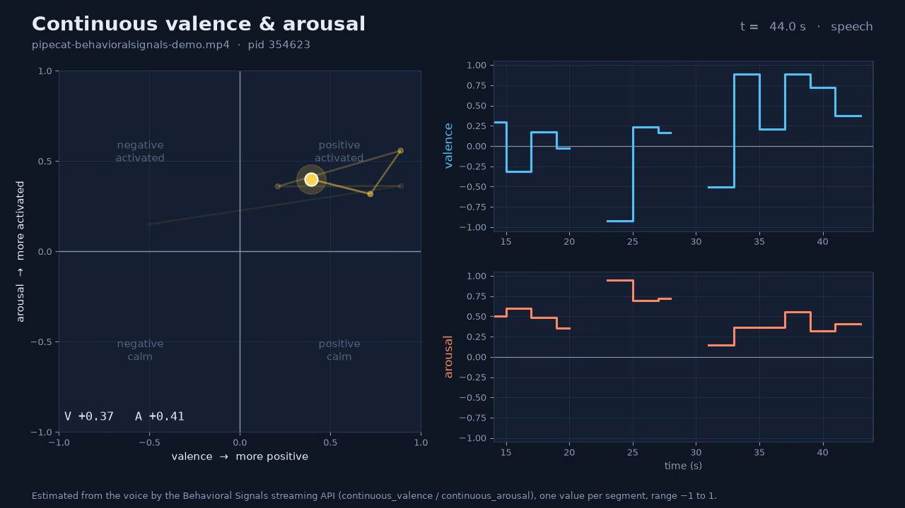

# Continuous valence and arousal demos

<div align="center">

[](https://github.com/BehavioralSignalTechnologies/continuous-va-demo/actions/workflows/ci.yml)
[](LICENSE)
[](pyproject.toml)
[](https://github.com/astral-sh/ruff)
[](https://github.com/astral-sh/uv)
[](https://behavioralsignals.readme.io/)
[](https://discord.com/invite/fxjRrbMH3Q)

</div>

Two demos of the **continuous valence and arousal** outputs of the
[Behavioral Signals streaming API](https://behavioralsignals.readme.io/), using the
[Python SDK](https://github.com/BehavioralSignalTechnologies/behavioralsignals-python)
(`behavioralsignals` 1.1.0 or later, `continuous=["valence", "arousal"]`).

- **(a) File → MP4**: stream an audio or video file and render a video of the
  valence/arousal plane, with the file as its sound track.
- **(b) Live microphone**: the same picture, live, while you speak.



Both ask for **segment-level** results only: one value per segment (usually 2 s,
sometimes shorter), available as soon as the segment ends, without waiting for an
utterance to close. Each segment gets a value from −1 to 1 for valence (how
positive the speaker sounds) and arousal (how activated). The values are
exactly the `continuous_valence` / `continuous_arousal` rows the API returns;
nothing is recomputed locally. The trail and the time panels show them as they
are; the moving dot glides to each new value over about a second.

## Setup

You need:

- Python 3.10 or later and [uv](https://docs.astral.sh/uv/)
- **ffmpeg** on the PATH: it decodes the input and encodes the MP4
  - macOS: `brew install ffmpeg`
  - Ubuntu/Debian: `sudo apt install ffmpeg libportaudio2 python3-tk` (PortAudio is
    needed for the microphone, tkinter for the live window)
  - Windows: `winget install ffmpeg`, then open a new terminal so it is on the PATH
- A Behavioral Signals account and API key, from the
  [Behavioral Signals portal](https://portal.behavioralsignals.com/)

```bash
git clone https://github.com/BehavioralSignalTechnologies/continuous-va-demo.git
cd continuous-va-demo
uv sync
```

Set your client ID (CID) and API key as environment variables, as for the SDK:

```bash
export BEHAVIORALSIGNALS_CID="your_cid"
export BEHAVIORALSIGNALS_API_KEY="your_api_key"
```

On Windows (PowerShell):

```powershell
$env:BEHAVIORALSIGNALS_CID = "your_cid"
$env:BEHAVIORALSIGNALS_API_KEY = "your_api_key"
```

**Both demos are billable** at the streaming rate per minute of audio.

## Try it

Any speech file works (wav, mp3, mp4, ...). To start with ours, download the
48 s sample (two short calls, an angry one and then a happy one) and render it:

```bash
curl -LO https://github.com/BehavioralSignalTechnologies/pipecat-behavioralsignals/releases/download/v0.2.0/pipecat-behavioralsignals-demo.mp4
uv run file_video.py pipecat-behavioralsignals-demo.mp4
```

(On Windows, type `curl.exe` instead of `curl`.) It prints one line per segment
as the values arrive and writes `out/pipecat-behavioralsignals-demo_va.mp4`;
the picture above is a frame of it.

Or talk into your microphone, then turn the session into a video:

```bash
uv run mic_live.py                         # speak, then close the window
uv run file_video.py out/mic_<time>.wav    # the file name it printed; no new streaming
```

Each script lists all its options with `--help`.

## (a) File → MP4

```bash
uv run file_video.py recording.wav               # -> out/recording_va.mp4
uv run file_video.py call.mp4 --latency 0.5      # show each value with the live delay
```

Streams the file (as fast as the server accepts; the server segments it the
same way as live), then renders a 1280×720 video whose sound track is the
input file: the V/A plane with a moving dot and a fading trail, and
valence/arousal time panels. A value appears when its segment ends (plus
`--latency`). Results are cached in `out/<stem>-<content hash>.points.json`
(keyed by the file's content, so two recordings with the same name never share
results), so re-rendering with other `--fps`, `--trail`, `--window` or
`--latency` is free; `--restream` forces a new pass.

## (b) Live microphone

```bash
uv run mic_live.py --list            # input devices
uv run mic_live.py --device 4        # pick one by number
uv run mic_live.py --simulate f.wav  # a file at real-time pace, no mic
```

Same picture, in a live window; close it or press Ctrl-C to stop. The session
is saved as `out/mic_<time>.wav` with its results, so
`uv run file_video.py out/mic_<time>.wav` turns it into an MP4 without
streaming again (`--no-save` to skip). If the stream failed or did not finish,
only the recording is saved, and rendering it streams it again.

Where no window can open (for example over SSH), pass `--seconds N` to run for
N seconds without one.

On macOS the terminal needs microphone permission (System Settings → Privacy &
Security → Microphone). Without it, macOS hands over silence and no values come
back; the window then shows "NO INPUT SIGNAL".

## What the picture means

- Gray dot / "no speech": no segment for 3 s. The API's own voice activity
  detection skips silence, so silent stretches carry no value.
- Live, a value arrives about 0.3–0.5 s after a 2 s segment ends, and about
  1.3 s after a shorter one.
- Values are estimates of the expressed signal in the voice, per segment, not
  a statement about the speaker's inner state. Use them to follow trends, not
  as exact measurements.

See [Continuous valence and arousal](https://github.com/BehavioralSignalTechnologies/behavioralsignals-python#continuous-valence-and-arousal)
in the SDK README for the API side.

Questions? Ask on [Discord](https://discord.com/invite/fxjRrbMH3Q) or open an
[issue](https://github.com/BehavioralSignalTechnologies/continuous-va-demo/issues).

## Development

```bash
uv sync --extra dev
uv run ruff check && uv run ruff format --check
uv run pytest
```

See [CONTRIBUTING.md](CONTRIBUTING.md). Please report security issues
according to [SECURITY.md](SECURITY.md).

## License

Licensed under the Apache License 2.0. See [LICENSE](LICENSE).
